# frpc-mesh

多实例 frp 内网穿透管理工具（WebUI），适合部署在 NAS / 软路由 / 任何 Docker 主机上。

核心特性：**同时管理多台远程 frps 服务器**。每台服务器对应一个独立的 frpc 进程与配置，可同时连接多台 frps（例如家里一台、公司一台、云上一台），组成穿透"网格"，所有隧道在一个 Web 界面里统一管理。

## 文档

| 文档 | 内容 |
|---|---|
| [docs/deployment.md](docs/deployment.md) | 三种部署方式（compose / 镜像包 / 普通包）、运行参数、首次登录 |
| [docs/operations.md](docs/operations.md) | 数据目录、备份恢复、账号重置、升级、安全边界、排错速查 |
| [API.md](API.md) | 后端 HTTP 接口契约 |

## 功能

- 多 FRPS 服务器：新增/编辑/删除，每台独立启动、停止、重启，互不影响；支持备注、管理端口、域名
- 每台服务器独立 frpc 子进程，TOML 配置自动生成（可预览），进程意外退出自动重启（连续快速退出熔断）
- 穿透代理全局页：TCP/UDP/HTTP/HTTPS/STCP/SUDP/XTCP 类型卡片快速创建，支持带宽限制、Basic Auth、自定义域名/子域名、加密压缩、启用/禁用开关、备注
- 隧道在线判定：日志关键字 + 本地目标数据层探测双重确认；「全部 Ping」并行测延迟
- 高级传输参数：STUN、心跳/保活/tcpMux/连接池等，默认值已按实测稳定性预设
- **frpc 版本管理**：在线扫描 GitHub Releases（官方/ghfast 镜像双数据源），下载指定版本、一键切换并自动重启运行中的 frpc 在线生效
- 配置备份：导出/导入 JSON（服务器+代理全量，导入即覆盖恢复）
- 实时状态自愈回刷、JWT 登录认证、登录失败分级锁定防爆破
- 单二进制部署：前端构建产物内嵌，SQLite 存储，无外部依赖

## 界面预览

> 截图全部来自一套**虚构的演示数据**（`127.0.0.1:7600`、`frps-demo.example.com`、`demo-token-2026`、`nas-ssh` 等），不含任何真实服务器信息。

**仪表盘** — 多台 frps 的连接状态与在线汇总
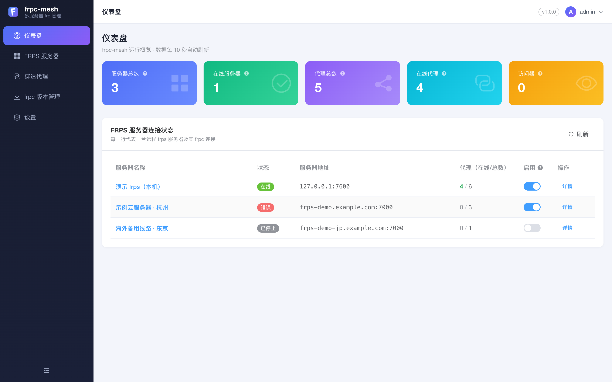

**FRPS 服务器** — 逐台状态、在线代理数、启用开关与重启/管理/编辑/删除
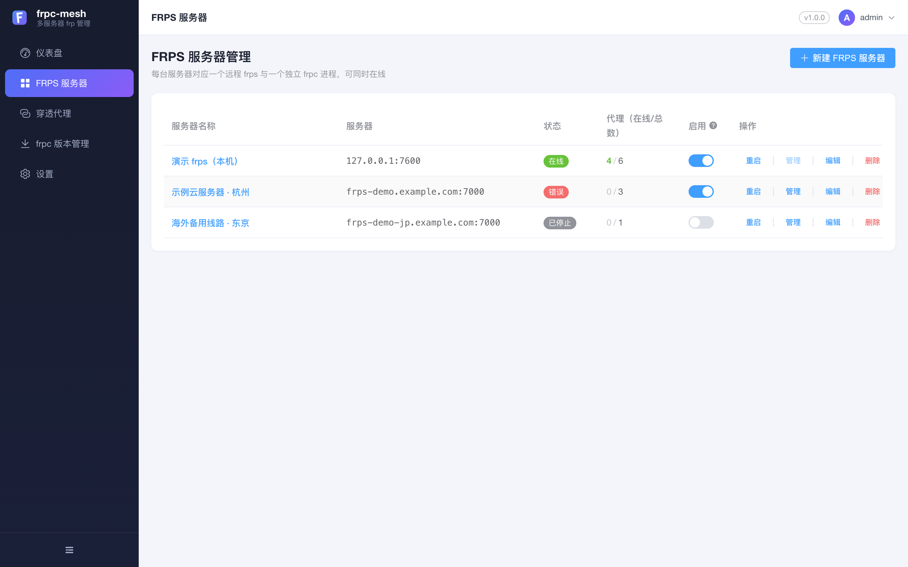

**穿透代理** — 按服务器分 Tab，类型卡片创建，在线状态与「全部 Ping」延迟
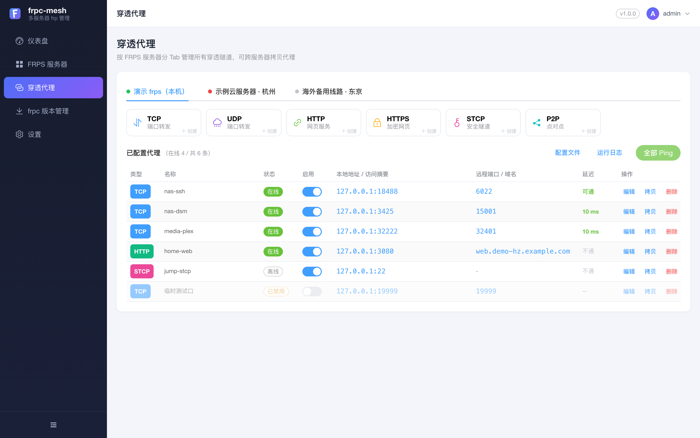

<details>
<summary>展开其余界面（表单 / 配置 / 日志 / 版本 / 设置）</summary>

**新建 FRPS 服务器** — 地址、Token、管理端口、域名、备注
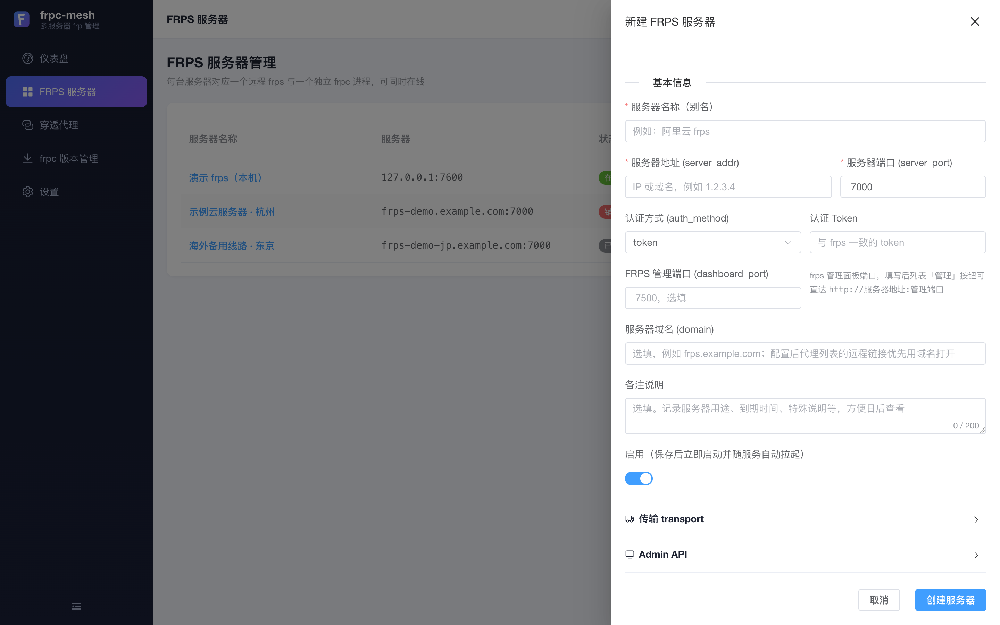

**传输 transport** — 协议、tcpMux、连接池、心跳、TLS
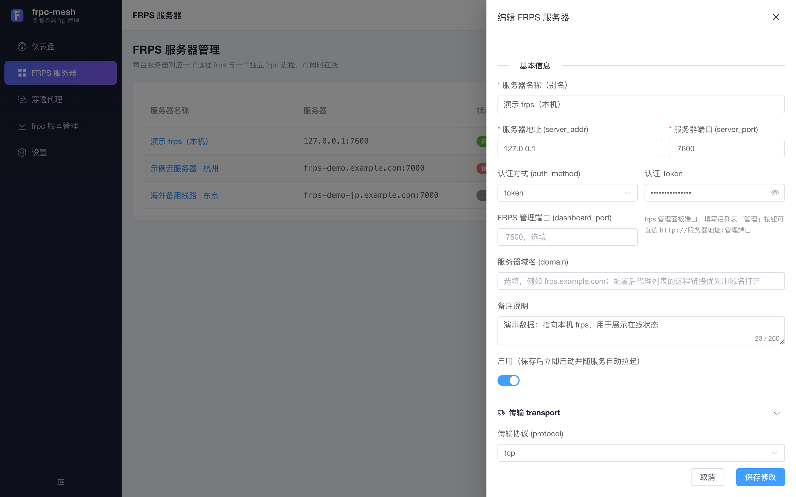

**Admin API** — 本机 frpc 管理端口，用于隧道明细
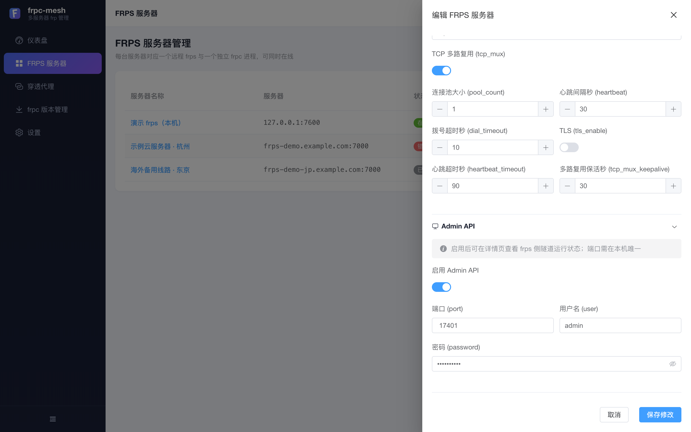

**新建 TCP 代理** — 本地地址可一键填入宿主机地址
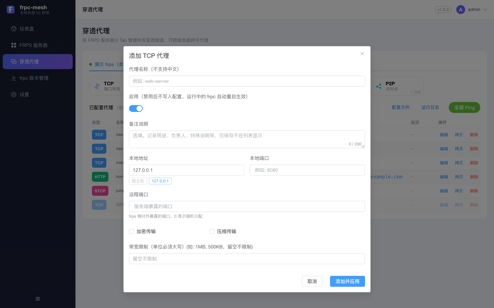

**新建 HTTP 代理** — 自定义域名 / 子域名 / 路径 / Basic Auth
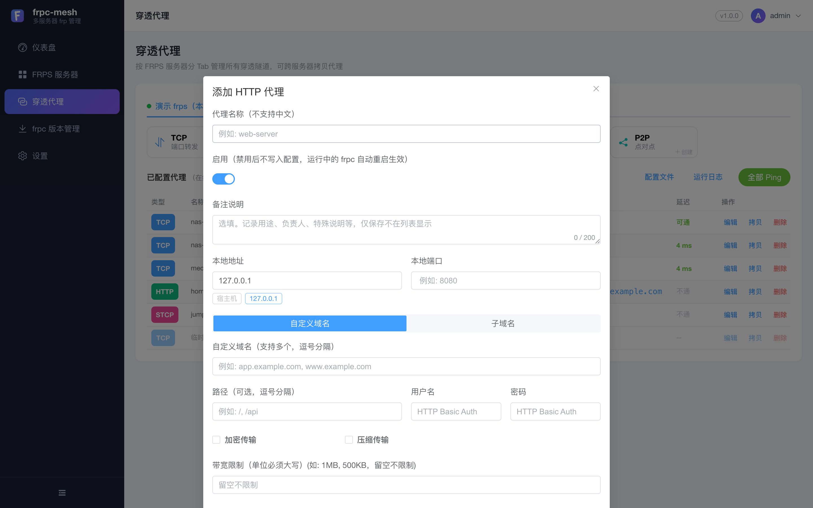

**编辑代理** — 启用开关、加密压缩、带宽限制
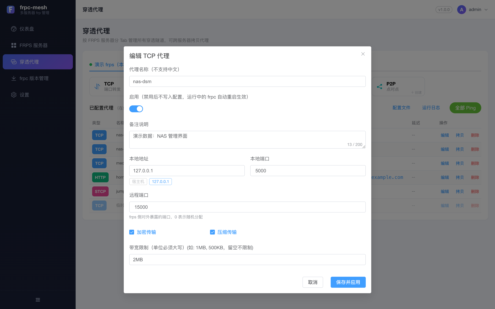

**配置文件预览** — 后端自动生成的 frpc TOML（只读、可复制）
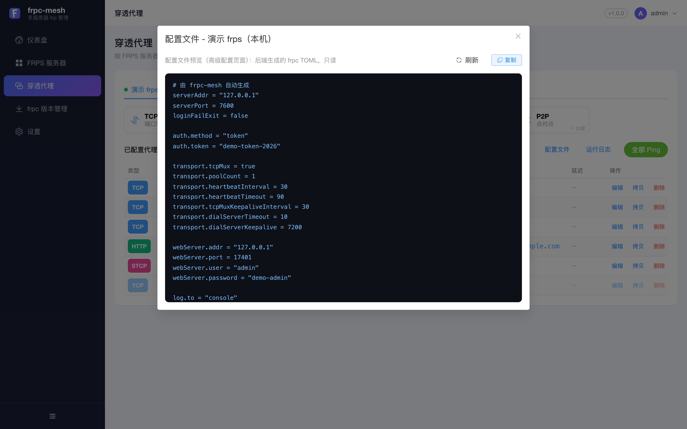

**运行日志** — 最近 500 行 frpc 输出，可自动刷新与清空
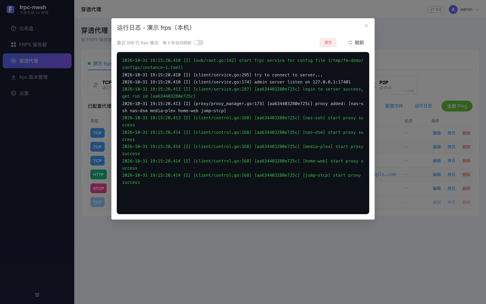

**frpc 版本管理** — 在线拉取 Releases、下载并一键切换
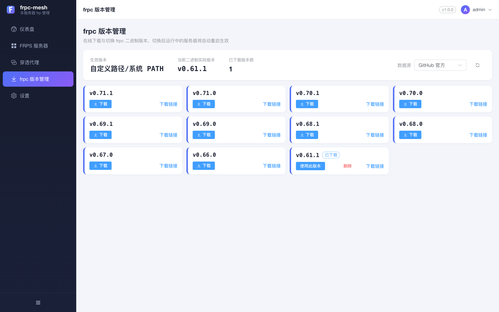

**设置** — frpc 生效版本、开机自启、备份导出导入、修改密码
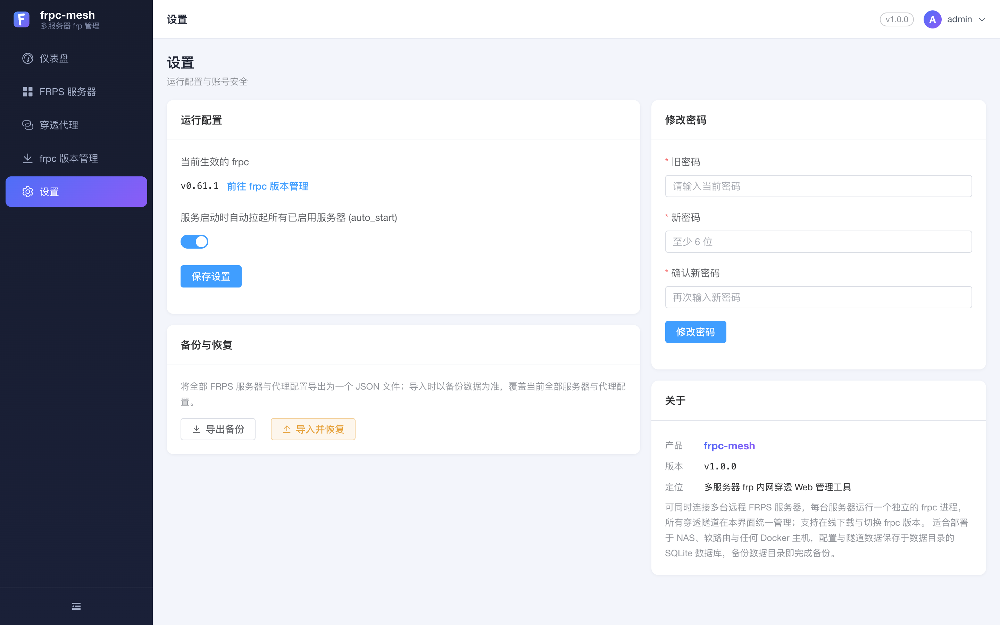

</details>

## 架构

```
浏览器 ──HTTP/JWT──▶ Go 后端 (net/http + SQLite + embed 前端)
                        │
                        ├── 服务器1 ──▶ frpc 子进程 ──▶ frps A（云端）
                        ├── 服务器2 ──▶ frpc 子进程 ──▶ frps B（公司）
                        └── 服务器3 ──▶ frpc 子进程 ──▶ frps C（VPS）
```

- 每台服务器生成 `<数据目录>/configs/instance-<id>.toml`，以 `frpc -c <toml>` 启动
- 状态判定：解析 frpc 日志（`login to server success` / `start proxy success` → 在线）；隧道明细走 frpc Admin API（`webServer` 仅监听 127.0.0.1）

## 快速上手

```bash
docker compose up -d --build     # 详见 docs/deployment.md（先按需改 compose 里的数据目录路径）
# 打开 http://<主机IP>:18080 ，默认账号 admin / admin123，登录后立即改密
```

使用流程：

1. **FRPS 服务器**页 → 新建服务器：填 frps 的 server_addr / server_port / token，启动
2. **穿透代理**页 → 类型卡片添加代理：填本地 IP:端口、远程端口
3. 在同一页查看在线状态/延迟，「全部 Ping」测连通；「配置文件」「日志」按钮排查问题
4. **设置**页确认 frpc 路径、开启开机自启、备份导出/导入

容器内穿透宿主机服务时，代理"本地 IP"填 `host.docker.internal`（表单有快捷芯片）；`127.0.0.1` 指向的是容器自身。

## 项目结构

```
├── main.go              # 入口：flag 解析、启动/优雅退出、--reset-password 工具模式
├── internal/            # 私有包（Go 惯例，外部模块不可引用）
│   ├── api/             # HTTP 路由与处理器（唯一对外入口）
│   ├── auth/            # JWT + bcrypt + 登录失败锁定
│   ├── model/           # 实体与备份结构定义
│   ├── netinfo/         # 宿主机网络探测（快捷填入提示）
│   ├── runner/          # frpc 子进程生命周期/日志解析/自动重启/版本管理
│   ├── store/           # SQLite 存储与迁移
│   └── tomlegen/        # frpc TOML 配置生成
├── web/                 # Vue3 + Element Plus 前端（构建产物 dist/ 被 go:embed 内嵌）
├── docs/                # 部署指南 / 维护手册 / screenshots 界面截图
├── API.md               # 接口契约
├── Dockerfile           # 三阶段构建（前端→后端→运行时）
├── docker-compose.yml   # 生产部署编排
└── Makefile             # build / dev / web / docker / release
```

`dist/`（构建产物，不入库）：交叉编译的普通运行包与各架构 Docker 镜像 tar，由 `make release` 生成。

## 本地开发

```bash
make web    # 构建前端到 web/dist
make build  # 编译单二进制 ./frpc-mesh
make dev    # 本机运行（127.0.0.1:18080）
make test   # go test ./...
```

前端开发模式：`cd web && pnpm dev`（/api 已代理到 18080）。

## License

MIT
