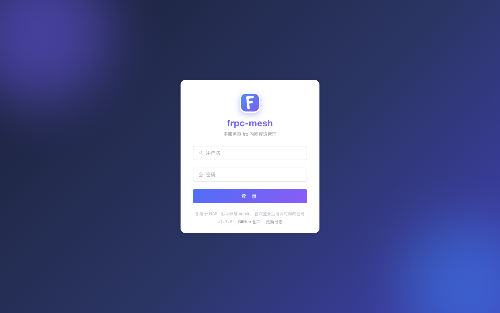

# frpc-mesh

[English](README.md) | [中文](README-CN.md)

[](https://github.com/busfly/frpc-mesh/stargazers)
[](https://github.com/busfly/frpc-mesh/releases)
[](LICENSE)

A web control panel for **frp** ([fatedier/frp](https://github.com/fatedier/frp)) that manages **several remote frps servers at the same time** — one `frpc` process per server. Designed to run on a NAS, a router box, or any Docker host.

The point of "mesh": each frps entry (home, office, cloud VPS, …) gets its own `frpc` child process and its own generated TOML, so all tunnels across all servers are listed, started, pinged and edited from a single page. It does **not** run frps itself — the server side is assumed to be up already.

## Documentation

| Doc | Contents |
|---|---|
| [docs/deployment.md](docs/deployment.md) | Three install paths (compose / image tar / plain binary tar), runtime flags, first login *(zh)* |
| [docs/operations.md](docs/operations.md) | Data directory, backup & restore, password reset, upgrade, frpc versions (default vs per-server), remote port conflicts, security boundaries, troubleshooting *(zh)* |
| [API.md](API.md) | Backend HTTP API contract *(zh)* |

> `docs/` is still Chinese-only; [README-CN.md](README-CN.md) is the reference version.

## Features

- **Multiple frps servers** — create / edit / delete, each started, stopped and restarted independently; notes, dashboard port, domain and an optional per-server frpc version
- One `frpc` child process per server, TOML generated automatically (and previewable); a process that dies unexpectedly is restarted, with a circuit breaker for crash loops
- **All tunnels on one page** — create via TCP / UDP / HTTP / HTTPS / STCP / SUDP / XTCP type cards; bandwidth limit, HTTP Basic Auth, custom domain / subdomain, encryption & compression, per-proxy enable switch, notes
- **Remote port conflict guard** — "same as local port" fills it in one click, "Check" reports whether that remote port is already taken (by another of your proxies on this server, or by an actual listener on frps); saving re-checks automatically and refuses to save an occupied port
- **Honest online status** — a tunnel counts as online only when frpc's log confirms it *and* the local target answers a data-layer probe; "Ping all" measures every tunnel in parallel
- Advanced transport knobs (protocol, tcpMux, pool count, heartbeat, dial timeout, TLS, STUN) shipped with defaults chosen from real-world stability testing
- **frpc version management** — browse upstream GitHub Releases (official source + a mirror source), download a version, switch to it, running frpc processes restart on the new binary. The switched version is the *default*; each server may pin its own, and a pin that is not downloaded yet starts on the default while the download runs in the background and the server restarts onto it once it lands
- **Self-update** — checks frpc-mesh's own latest GitHub Release (official or mirror, optionally on a schedule) and reminds you in the header; when running as a plain binary it can upgrade in place (sha256 verified, new binary self-checked, `.bak` kept for rollback, tunnels drop for a few seconds then recover), while a container deployment is pointed at reloading the image instead
- Config backup — export / import one JSON file (servers + proxies; importing overwrites)
- JWT login with tiered lockout after repeated failures; state re-reads itself after every write
- Single static binary — the built frontend is embedded, state lives in SQLite, no external dependencies

## Screenshots

> Every screenshot comes from a **throwaway demo dataset** (`127.0.0.1:7600`, `frps-demo.example.com` / `frps-hz.example.com` / `frps-jp.example.com`, `demo-token-2026`, `nas-ssh`, …). No real host, port or token appears. The UI is currently Chinese-only — captions below are translated for reference.

**Dashboard** — connection state, effective frpc version and online totals for every frps


**FRPS servers** — per-server status, frpc version (default / pinned / pinned-but-not-downloaded yet), online proxy count, enable switch, restart / manage / edit / delete


**Proxies** — one tab per server (with its frpc version), type cards for creation, online state and ping latency


<details>
<summary>Remaining screens (forms / config / logs / versions / settings / login)</summary>

**New FRPS server** — address, token, dashboard port, domain, frpc version (empty follows the default), notes


**Transport** — protocol, tcpMux, pool count, heartbeat, TLS


**Admin API** — the local frpc admin endpoint used for tunnel details


**New TCP proxy** — the local address can be filled with the host address in one click; the remote port has "same as local" and a check that names whoever occupies it


**New HTTP proxy** — custom domain / subdomain / path / Basic Auth


**Edit proxy** — enable switch, remote port check, encryption & compression, bandwidth limit


**Config preview** — the frpc TOML generated by the backend (read-only, copyable)


**Logs** — the last 500 lines of frpc output, auto-refresh and clear


**frpc versions** — fetch Releases, download, switch the default; a version pinned by a server comes back on its own at the next start or when that server is saved


**Settings** — default frpc version, start-on-boot, frpc-mesh version check & one-click upgrade, backup export/import, change password, links to this repository


**Login** — version plus the GitHub repository / changelog links (the same set of links sits on the header octocat and in Settings → About)


</details>

## Architecture

```
browser ──HTTP/JWT──▶ Go backend (net/http + SQLite + embedded frontend)
                          │
                          ├── server 1 ──▶ frpc child ──▶ frps A (cloud)
                          ├── server 2 ──▶ frpc child ──▶ frps B (office)
                          └── server 3 ──▶ frpc child ──▶ frps C (VPS)
```

- Each server writes `<data dir>/configs/instance-<id>.toml` and is launched as `frpc -c <toml>`
- Which frpc binary a server gets: its own pinned version (when downloaded) → the default version activated on the versions page → a frpc found on the host. A pin that is missing starts on the default while the download runs in the background, then restarts onto it automatically
- Status: a server is online only when frpc's log confirms it (`login to server success` / `start proxy success`) *and* the local target answers a data-layer probe; tunnel details come from the frpc Admin API, whose `webServer` binds to 127.0.0.1 only

## Quick start

```bash
docker compose up -d --build     # see docs/deployment.md (adjust the data dir in compose first)
# then open http://<host>:18080 — default login admin / admin123, change it immediately
```

Typical flow:

1. **FRPS 服务器** (servers) → create one: frps `server_addr` / `server_port` / token, optionally pin an frpc version for it, then start it
2. **穿透代理** (proxies) → pick a type card → local `ip:port` and remote port (fill "same as local" and check it if you are not sure the port is free)
3. Same page: watch online status, hit **Ping all** for latency, open **配置文件 / 运行日志** (config / logs) when something is off
4. **设置** (settings) → confirm the default frpc binary, enable start-on-boot, export a backup

When frpc-mesh itself runs in a container and you tunnel to a service on the host, the proxy's **local address** must be `host.docker.internal` (the form has a one-click chip for it) — `127.0.0.1` points at the container.

## Project layout

```
├── main.go              # entry: flags, graceful shutdown, --reset-password tool mode
├── internal/            # private packages (Go convention: not importable)
│   ├── api/             # HTTP routes and handlers (the only outward entry point)
│   ├── auth/            # JWT + bcrypt + login lockout
│   ├── model/           # entities and backup schema
│   ├── netinfo/         # host network probing (quick-fill hints)
│   ├── runner/          # frpc process lifecycle / log parsing / restart / versions
│   ├── store/           # SQLite storage and migrations
│   └── tomlegen/        # frpc TOML generation
├── web/                 # Vue3 + Element Plus frontend (dist/ embedded via go:embed)
├── pack-base/           # release payload: start.sh (shared) + frpc-<version>/<platform>/frpc
├── docs/                # deployment / operations guides / screenshots
├── API.md               # API contract
├── Dockerfile           # three-stage build (frontend → backend → runtime)
├── docker-compose.yml   # production compose
└── Makefile             # build / dev / web / docker / release
```

`dist/` (build output, not committed) holds the per-platform binary tarballs — each ships a bundled `frpc` base binary — plus the arm64 Docker image tar, all produced by `make release`. Tagged builds are published on [Releases](../../releases).

## Development

```bash
make web    # build the frontend into web/dist
make build  # compile the single binary ./frpc-mesh
make dev    # run locally on 127.0.0.1:18080
make test   # go test ./...
make release GO=go  # assemble dist/ packages
```

Frontend hot reload: `cd web && pnpm dev` (it proxies `/api` to 18080).

## Support the project

If frpc-mesh saves you babysitting several `frpc` processes, [star the repo](https://github.com/busfly/frpc-mesh) — that's how new users (and contributors) find it. Bugs and feature requests go to [Issues](https://github.com/busfly/frpc-mesh/issues/new).

## License

MIT
